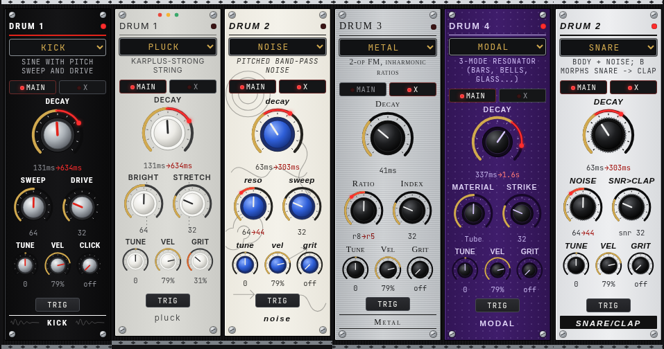

# Workshop Tracker

**▶ [Web-App öffnen](https://gordonbleu-modular.github.io/computer-tracker/)** (Chrome oder Edge) · [Firmware herunterladen](https://github.com/gordonbleu-modular/computer-tracker/releases)

Ein **Tracker-Sequencer mit vier Drum-Synth-Stimmen** für das
**Computer**-Modul des
[Music Thing Modular Workshop System](https://www.musicthing.co.uk/workshopsystem/),
dazu ein **Browser-Editor**, der es über USB steuert.

* **4 Drum-Stimmen auf dem Modul**, jede mit einer von sechs Engines: Kick,
  Pluck, Noise, Metal, Modal, Snare/Clap.
* **2 CV/Gate-Spuren**, die die zwei analogen VCOs des Workshop Systems
  spielen (1 V/Okt an CV Out 1/2, Gates an Pulse Out 1/2).
* **Audio In 1/2** holen die VCOs über je einen VCA zurück in den Mix,
  gespielt von eigenen **IN-Spuren**.
* Ein **Stereo-Mixer** mit **Lo-Fi-Reverb** auf einem Send, an Audio Out 1/2.
* **16 Patterns × 64 Zeilen × 8 Spuren**, ein Effekt pro Step,
  Song-Arrangement, Tempo und Swing. Alle Werte werden als **00–99** eingegeben.
* **Spielbar ohne Computer**: 6 Song-Slots im Flash, Start / nächster Teil /
  Stopp, Regler-Makros, externe Clock und Reset.

English: [README.md](README.md)

## Schnellstart

1. **Karte flashen:** Karte im Computer, USB eingesteckt, den BOOTSEL-Knopf
   (hinter dem Hauptregler) halten, Reset antippen und
   `workshop_tracker.uf2` (aus den [Releases](https://github.com/gordonbleu-modular/computer-tracker/releases) oder `dist/`) auf das Laufwerk `RPI-RP2` ziehen
   ([offizielle Anleitung](https://www.musicthing.co.uk/workshopsystem/program-cards/install/)).
2. **Patchen:** Audio Out 1/2 → Kopfhörer oder Mixer (L/R). Für die VCOs siehe
   [Audio-Routings](#audio-routings-mit-den-zwei-vcos).
3. **Editor öffnen** in Chrome oder Edge (WebMIDI mit SysEx):
   <https://gordonbleu-modular.github.io/computer-tracker/> (oder lokal: `cd web && python3 -m http.server 8000`
   → <http://localhost:8000>).
4. **Connect** und MIDI/SysEx erlauben. Änderungen spielt das Modul sofort;
   **Save to module** speichert den Song im gewählten Slot.
5. USB jederzeit abziehen: das Modul spielt über sein Panel weiter.

Der Editor funktioniert auch offline; Songs lassen sich als `.wtrk.json`
exportieren.

## Das Modul allein

| Z | Main | X | Y |
| --- | --- | --- | --- |
| **Mitte** (PERFORM) | Decay-Makro (an MAIN geroutete Drum-Stimmen, CV-Gate-Länge, IN-VCA-Decay) | Colour-Makro (Parameter A der an X gerouteten Stimmen, CV-Glide, IN-Drive) | Master-Filter: links Tiefpass, rechts Hochpass |
| **Oben** (SELECT) | Song-Slot (der Regelweg wird auf die gespeicherten Slots aufgeteilt) | Tempo 40–240 BPM | Swing 50–75 % |
| **Unten** (Taster) | Tippen: Start / nächster Song-Teil · 0,8 s halten: Stopp | | |

Makros sind **Offsets** auf den Song: nie gespeichert, zurück auf 12 Uhr = der
Song wie programmiert. Welche Stimmen sie erreichen, legen die Tasten
**MAIN** / **X** an jedem Modul im Editor fest. Die Regler haben Soft
Takeover. Pulse In 1 ist ein Clock-Eingang (1 Puls = 1 Zeile), Pulse In 2
setzt zurück, CV In 1 transponiert beide CV-Spuren, CV In 2 verschiebt das
Master-Filter. Beim Einschalten wird der letzte Slot geladen, gestoppt.
Komplette Belegung und LEDs: [docs/CONTROLS.md](docs/CONTROLS.md).

## Drum-Stimmen

Jedes Drum-Modul wählt eine Engine; die Frontplatte wechselt mit. Alle Module
haben dieselben Regler:

| Regler | Funktion |
| --- | --- |
| **Decay** | Länge des Klangs |
| **A**, **B** | zwei Klangparameter, je nach Engine verschieden (unten) |
| **Tune** | ±48 Halbtöne zusätzlich zur Note im Raster |
| **Vel** | Velocity-Empfindlichkeit, siehe [Velocity](#velocity) |
| **Click / Grit** | Kick: Schlägel-Klick. Alle anderen Engines: Grit. 0 = aus |
| **MAIN / X** | ob das Main- / X-Makro diese Stimme erreicht |
| **TRIG** | spielt die Stimme einmal |

| Engine | Klang | A | B |
| --- | --- | --- | --- |
| **Kick** | Sinus mit fallendem Pitch-Sweep und Soft-Clip-Drive | **Sweep**: Tiefe des Pitch-Abfalls | **Drive**: Sättigung |
| **Pluck** | gezupfte Karplus-Strong-Saite | **Bright**: Helligkeit des Anschlags | **Stretch**: niedrig = dunkel und gedämpft, hoch = hell und gestreckt |
| **Noise** | Rauschen durch einen resonanten Bandpass auf der Note | **Reso**: von Rauschen bis Pfeifen | **Sweep**: wie weit über der Note das Filter startet, bevor es auf die Note fällt |
| **Metal** | 2-Operator-FM mit unharmonischen Verhältnissen: Glocken, Cowbells, metallische Hats | **Ratio**: 16 Frequenzverhältnisse | **Index**: FM-Menge (Helligkeit) |
| **Modal** | kurzer Anschlag in drei gestimmte Resonatoren | **Material**: Membran, Marimba, Glockenspiel, Glocke, Röhre, Platte, Glas, Gong | **Strike**: Härte des Anschlags |
| **Snare** | Sinus-Körper mit Pitch-Drop plus Rauschen, morpht zum Clap | **Noise**: Rauschen gegen Körper | **Snr>Clap**: Snare → Clap-Morph |

**Kick: Click.** Ein kurzer (≈ 1,5 ms) Schlägel-Klick auf der Kick:
hochpassgefiltertes Rauschen und ein 1,6-kHz-Blip, lauter mit der
Step-Velocity, durch den Drive der Kick. Anhören:
[kick_click.wav](docs/audio/kick_click.wav).

**Snare: Snare → Clap.** B bis 44 ist die Snare (nach rechts heller), ab 84
der Clap (drei Rauschstöße, nach rechts weiter auseinander). Dazwischen gehen
beide stufenlos ineinander über: die Rauschfarbe gleitet, die zusätzlichen
Clap-Stöße werden eingeblendet. Anhören:
[snare_clap_morph.wav](docs/audio/snare_clap_morph.wav).

**Grit** (Pluck, Noise, Metal, Modal, Snare). Ein Lo-Fi-Fuzz am Ausgang der
Stimme: Drive in ein hartes Clipping, weniger Bits und ab 25 % eine niedrigere
Abtastrate (bis 12 kHz). Er macht die Stimme lauter (bis ≈ +10 dB), also den
Level im Mixer zurücknehmen. Anhören: [grit_demo.wav](docs/audio/grit_demo.wav).
Grit auf ein oder zwei Stimmen ist unproblematisch; Grit auf allen vier in
einem sehr dichten Pattern mit viel Reverb kann das Modul knacksen lassen.

## Mixer und Reverb

Kanäle DR1–DR4, IN1, IN2: **Level, Pan, Drive, Tone** (links dunkler, rechts
dünner, Mitte neutral), **Send** zum Reverb und ein **Mute**. Die IN-Kanäle
haben zusätzlich ihren VCA (siehe unten). Der Master hat ein Filter (Regler
Y) und Drive. REVERB und MASTER haben Live-Mute-Schalter (nicht gespeichert).

Der **Lo-Fi-Reverb** ist ein bewusst körniger Stereo-Hall:

| Regler | Funktion |
| --- | --- |
| Return | Hallanteil im Master (≈ 71 % = 0 dB) |
| Size | Raumgröße; Drehen verbiegt die Tonhöhe der Fahne etwas, wie Band |
| Decay | 0,3–9 s |
| Tone | dunkle … helle Fahne |
| Lo-fi | sauber … körnig: weniger Bits, langsames Leiern, ab 50 % Sample-and-Hold |

Anhören: [demo_dry.wav](docs/audio/demo_dry.wav) und
[demo_reverb.wav](docs/audio/demo_reverb.wav).

## Audio-Routings mit den zwei VCOs

| Buchse | Funktion |
| --- | --- |
| CV Out 1 / 2 | Tonhöhe von CV-Spur 1 / 2, 1 V/Okt, **C-0 = 0 V … B-5 = 5,92 V** (die Oktavziffer ist die Spannung) |
| Pulse Out 1 / 2 | Gate von CV-Spur 1 / 2 |
| Audio In 1 / 2 | Mixer-Kanäle IN1 / IN2, je über einen VCA |
| CV In 1 | transponiert beide CV-Spuren (1 V/Okt, oktavweise zurückgefaltet, nie unter 0 V) |
| CV In 2 | wird zum Master-Filter addiert |
| Pulse In 1 / 2 | Clock (1 Puls = 1 Zeile) / Reset |

**Grund-Patch:** CV Out 1 → Pitch VCO 1, CV Out 2 → Pitch VCO 2, Ausgang VCO 1
→ Audio In 1, Ausgang VCO 2 → Audio In 2. Im Tab **CV / IN** wird eingestellt,
wie der VCA jedes Eingangs öffnet:

* **CV GATE**: der VCA folgt dem Gate von CV-Spur 1 / 2, der VCO klingt also
  nur, solange seine Note spielt. Der einfachste Weg zu Bass- oder Lead-Linie.
* **IN TRACK**: der VCA wird von einer eigenen Spur (IN1 / IN2) gespielt: TRIG
  öffnet ihn, LVL setzt den Pegel, dazu Hold (G), Decay (D), Ratchets,
  Wahrscheinlichkeit. Der VCO kann durchlaufen, während die IN-Spur ihn
  rhythmisch zerhackt, unabhängig von der Melodie auf der CV-Spur.
* **OPEN**: immer offen, z. B. für einen Drone oder wenn Hüllkurve und VCA
  woanders im System die Form machen.

Pro CV-Spur gibt es im Tab CV / IN außerdem **Gate-Länge, Glide,
Transpose**, pro Eingang **Decay, Hold, Drive** und das MAIN-/X-Routing der
Makros.

**Ideen:**

* Pulse Out 1/2 → eine Hüllkurve im System, die den VCO über Filter oder VCA
  des Systems formt, bevor er in Audio In 1/2 zurückkommt: das Modul wird
  Sequencer und Mixer für eine vollständig analoge Stimme.
* Beide VCOs am selben CV Out (CV Out 1 mit Stapelkabel an beide
  Pitch-Eingänge), leicht verstimmt: eine fette Stimme, IN1 und IN2 links und
  rechts gepannt.
* CV-Spur 1 als Bass mit VCA-Quelle CV GATE, CV-Spur 2 als Lead mit
  `S`-Slides, deren VCA die IN2-Spur rhythmisch spielt.
* IN1/IN2 mit dem Effekt `W` nur auf einzelnen Hits in den Reverb schicken:
  Dub-artige Hall-Würfe.
* Ein langsamer LFO oder Zufallsspannung an CV In 1 transponiert die
  CV-Spuren; an CV In 2 fährt er das Master-Filter.
* Eine externe Clock an Pulse In 1 synchronisiert den Tracker mit dem System
  (ein Puls pro Zeile, Swing gilt weiter).

## Das Tracker-Raster

Spalten: Drum-Spuren **NOTE VEL FX**, CV-Spuren **NOTE FX**, IN-Spuren
**TRIG LVL FX**. `..` = Standard. Die Note `OFF` (Taste `1`) würgt eine Drum
ab, schließt ein CV-Gate oder einen IN-VCA. Unter dem Raster zeigt eine
Tastatur-Skizze, welche Computer-Taste welche Note spielt (Klavier-Layout auf
`Y S X D C…` bei QWERTZ bzw. `Z S X D C…` und `Q 2 W 3 E…`). **Keys** im
Editor listet alle Tastenkürzel.

### Step-Effekte

Jeder Step hat **einen Effekt**: einen Buchstaben und einen Wert 00–99. Den
Buchstaben in die FX-Spalte tippen oder Enter für eine Liste drücken; die
Statuszeile erklärt ihn.

| FX | Spuren | Wert | Funktion |
| --- | --- | --- | --- |
| `A` | Drum | 00–99 | **Parameter A** nur für diesen Schlag (Sweep, Bright, Reso, Ratio, Material, Noise) |
| `B` | Drum | 00–99 | **Parameter B** nur für diesen Schlag (z. B. Snare ↔ Clap pro Schlag) |
| `D` | Drum, IN | 00–99 | **Decay** nur für diesen Schlag (IN: VCA-Release) |
| `G` | CV, IN | 00–64 | **Gate-Länge** in 1/16 Zeile: 08 = halbe Zeile, 16 = eine Zeile, 64 = vier Zeilen, 00 = halten bis zur nächsten Note oder OFF |
| `S` | CV | 00–99 | **Slide**: in der angegebenen Zeit zu dieser Note gleiten (bis ≈ 2 s); das Gate bleibt offen (legato), wenn die vorige Note noch klingt |
| `R` | alle | 02–08 | **Ratchet**: die Note wiederholt sich 2–8-mal in der Zeile (CV/IN-Gates: halbe Wiederholungslänge) |
| `P` | alle | 00–99 | **Wahrscheinlichkeit** in %, dass der Step spielt (00 = nie; ohne P = immer) |
| `K` | alle | 01–15 | **Verzögerung**: spielt den Step n/16 Zeile später (08 = halbe Zeile, Offbeat) |
| `W` | Drum, IN | 00–99 | **Reverb-Send** für diesen Schlag statt des Send-Reglers (50 ≈ −12 dB, 99 = voll); die Fahne des Schlags behält ihn, der nächste Schlag ohne W nimmt wieder den Regler |

Die Panel-Makros wirken auf `A`- und `D`-Locks genauso wie auf die Reglerwerte.

### Velocity

* **VEL-Spalte (Drum-Spuren):** wie stark der Step angeschlagen wird, 01–99;
  `..` = 79 (der Standard-Schlag).
* **Vel-Regler (an jedem Drum-Modul):** wie stark die VEL-Spalte die
  Lautstärke ändert: `Pegel = 127 − (127 − VEL) × Vel / 128` (in der internen
  Skala 0–127). **0 %** = jeder Schlag voll (VEL ignoriert), **100 %** = VEL
  bestimmt den Pegel ganz; Standard 79 %. Zum Beispiel eine Kick auf 0 %, die
  immer voll kommt, und Hats auf 100 %, die ihren Akzenten folgen. Die Velocity
  skaliert auch den Klick der Kick.
* **LVL-Spalte (IN-Spuren):** der VCA-Pegel dieses Triggers, `..` = voll.
* **CV-Spuren** haben keine Velocity: ein Gate ist an oder aus. Ein IN-VCA,
  der dem CV-Gate folgt, öffnet voll; die Lautstärke kommt vom Mixer.

## Mehr

Protokoll und Song-Format: [docs/PROTOCOL.md](docs/PROTOCOL.md) · CPU-Last:
[docs/CPU_BUDGET.md](docs/CPU_BUDGET.md) · Panel-Details:
[docs/CONTROLS.md](docs/CONTROLS.md).

## Lizenz

MIT, siehe [LICENSE](LICENSE). ComputerCard ist MIT © Chris Johnson
(`vendor/ComputerCard/LICENSE`).
