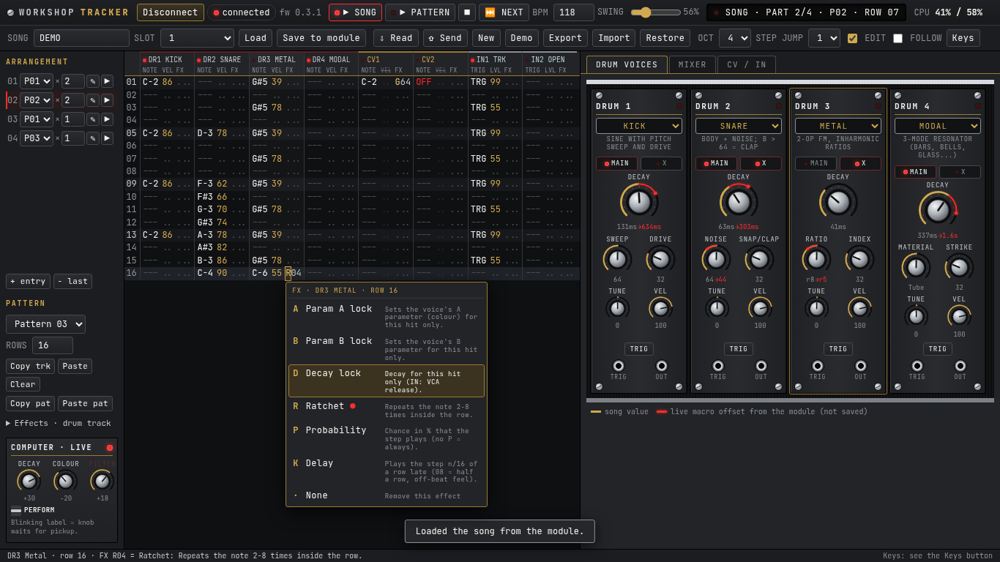

# Workshop Tracker

Ein **Tracker-Sequencer mit Drum-Synths** als Programmkarte für das
**Computer**-Modul (RP2040) des
[Music Thing Modular Workshop System](https://www.musicthing.co.uk/workshopsystem/),
dazu ein **Browser-Editor**, der das Modul über USB steuert.

* **4 Drum-Synth-Stimmen** laufen **auf dem Modul**: Kick, Karplus-Strong-Pluck,
  gestimmtes Bandpass-Rauschen, 2-Operator-FM „Metal“, 3-Moden-Resonator
  „Modal“, Snare/Clap.
* **Stereo-Mixer** (Level, Pan, Drive, Tone, Mute + Master-Filter/Drive) auf
  **Audio Out 1/2**.
* **2 CV/Gate-Spuren** für die beiden analogen VCOs: kalibriertes
  **1 V/Okt an CV Out 1/2**, Gates an **Pulse Out 1/2**, Glide/Slide.
* **Audio In 1/2** holen die VCOs zurück in den Mix, jeweils durch einen
  **VCA**, den eine eigene **IN-Spur** spielt (Trigger, Lautstärke, Haltezeit,
  Decay, Effekte) oder das Gate und die Velocity der CV-Spur.
* **Tracker**: 16 Patterns × 64 Zeilen × **8 Spuren** (4 Drums, CV1, CV2, IN1,
  IN2). Jeder Step hat Note, Velocity und **einen Effekt** (Parameter-Locks,
  Ratchets, Wahrscheinlichkeit, Mikro-Delay, Gate-Länge, Slide). Werte werden
  als **00–99** angezeigt und eingegeben. Song-Arrangement mit 32 Einträgen,
  Tempo, Swing.
* **Performance-Modus ohne Computer**: 6 Song-Slots im Flash, Start / nächster
  Part / Stop mit dem Z-Schalter, Makro-Regler, externe Clock & Reset,
  CV-Modulation.

> **Status:** Die Versionen 0.1 und 0.2 liefen auf einem echten Computer (USB,
> Klang, Panel, Knopf-Rückmeldung, Editor). Die Neuerungen in **0.3** (IN-Spuren,
> CV/IN-Makros, neues Slot-Format im Flash, Fix für die Slot-Auswahl,
> Timing-Änderungen im Audio-Kern; 0.3.1 entfernt die zweite Effektspalte von
> 0.3.0 wieder) sind durch Host-Tests, einen
> JS↔Firmware-Abgleich und Browser-Tests gegen ein simuliertes Modul
> abgedeckt, **liefen aber noch nicht auf Hardware**.
> Siehe [Bekannte Risiken](#bekannte-risiken).

English: [README.md](README.md)

## Schnellstart

1. **Karte flashen.** `workshop_tracker.uf2` herunterladen (`dist/` oder
   GitHub-Release). Karte im Computer, USB-C am Rechner: Hauptregler abziehen,
   den BOOTSEL-Knopf dahinter halten und den Load/Reset-Knopf neben dem
   Kartenschacht kurz drücken. Die UF2 auf das Laufwerk `RPI-RP2` ziehen.
   (Offizielle Anleitung:
   <https://www.musicthing.co.uk/workshopsystem/program-cards/install/>)
2. **Patchen** (Minimum): Audio Out 1/2 → Mixer / Kopfhörer (Stereo L/R).
   Für die VCOs: CV Out 1 → Pitch VCO 1, CV Out 2 → Pitch VCO 2, VCO-Ausgänge
   → Audio In 1/2. Pulse Out 1/2 sind Gates (für Hüllkurven / VCAs).
3. **Editor öffnen** in Chrome oder Edge:
   *GitHub Pages:* `https://<dein-user>.github.io/mtm-tracker/`
   *oder lokal:* `npx serve web` → <http://localhost:3000>
   (oder `cd web && python3 -m http.server 8000` → <http://localhost:8000>).
   Es muss `https://` oder `localhost` sein. `index.html` direkt von der Festplatte öffnen funktioniert nicht, weil WebMIDI-SysEx einen sicheren Kontext braucht.
4. **Connect** klicken und MIDI/SysEx erlauben. Der Editor liest den Song vom
   Modul. Änderungen gehen sofort ans Modul; **Save to module** speichert den
   Song im gewählten Flash-Slot.
5. USB jederzeit abziehen: Das Modul läuft weiter und wird über das Panel
   gespielt (siehe [docs/CONTROLS.md](docs/CONTROLS.md), englisch).

Der Editor funktioniert auch **offline** (ohne Modul). Songs werden im
Browser automatisch gesichert und lassen sich als `.wtrk.json`
exportieren/importieren.

## Der Editor

| Bereich | |
| --- | --- |
| Oben | Connect, Transport (Song / Pattern / Stop / nächster Part), BPM, Swing, CPU-Last des Moduls |
| Werkzeugleiste | Songname, Flash-Slot laden/speichern, vom Modul lesen / ans Modul senden, Neu, Demo, Export/Import, Oktave, **STEP JUMP** (um wie viele Zeilen der Cursor nach einer Eingabe springt), Edit-Modus, Follow |
| Links | Song-Arrangement (Pattern × Wiederholungen, ▶ startet bzw. springt zu einem Eintrag), Pattern-Auswahl & -Länge, Kopieren/Einfügen/Löschen, **Effekt-Legende** für die Spur unter dem Cursor |
| Mitte | das Tracker-Raster; darunter eine **Statuszeile**, die das Feld unter Maus oder Cursor erklärt |
| Links unten | **Computer · Live**: die Regler Main/X/Y und die Z-Stellung des Moduls in Echtzeit |
| Rechts, Tab **Drum voices** | vier Module im Eurorack-Stil: Engine, Zuordnungs-Tasten **MAIN** / **X**, Drehregler Decay, A, B, Tune, Vel; die rote LED leuchtet bei jedem Schlag |
| Rechts, Tab **Mixer** | DR1–DR4, **IN1**, **IN2** (Audio-Eingänge) und Master: Level, Pan, Drive, Tone, VCA-Decay (Eingänge), Mute, Pegel, Master-Filter |
| Rechts, Tab **CV / IN** | **CV/GATE 1, 2**: Gate-Länge, Glide, Transponierung, MAIN/X-Zuordnung · **CV RANGE**: 0-V-Note · **IN 1, 2 VCA**: Quelle (OPEN / CV GATE / IN TRACK), Decay, Hold, Drive, MAIN/X-Zuordnung, TEST |

**Drehregler:** hoch/runter ziehen (Shift = fein), Mausrad, Doppelklick
setzt zurück, mit Fokus auch Pfeiltasten / Bild↑↓ / Pos1 / Ende.

**Rückmeldung vom Modul (ab Firmware 0.2):** Die PERFORM-Makros des Moduls
sind **Offsets** auf die Werte im Song und werden nie gespeichert. Im Editor
zeigt der **goldene Bogen** den Song-Wert und ein **roter Bogen mit Punkt**,
was das Modul gerade spielt (Main: Drum-Decay, CV-Gate-Länge, IN-VCA-Decay;
X: Parameter A, CV-Glide, IN-Drive; Master-Filter über Y + CV In 2). Tempo,
Swing, Slot und Position vom Panel werden live angezeigt. Pro Drum-Voice,
CV-Spur und Audio-Eingang legen **MAIN** und **X** fest, ob das Main- bzw.
X-Makro darauf wirkt. Die Zuordnung wird im Song gespeichert.

### Das Raster

Jede Spur hat kleine Spalten-Labels: **NOTE VEL FX** (IN-Spuren:
**TRIG LVL FX**). Jeder Step hat einen Effekt. Zeilen und Patterns zählen ab 01.
Alle Werte sind zwei Dezimalziffern, **00–99** (intern wo nötig 0–127); `..`
heißt „Standard“. Die Schriftgröße des Rasters passt sich dem Fenster an, damit
alle 8 Spuren ohne seitliches Scrollen passen (12 px bei 1366×768, 16 px bei
1920×1080).

| Spur | NOTE / TRIG | VEL / LVL |
| --- | --- | --- |
| Drum 1–4 | Tonhöhe, `OFF` würgt ab | Anschlagstärke (`..` = 79) |
| CV1, CV2 | Tonhöhe an CV Out, Gate an Pulse Out, `OFF` = Gate aus | Lautstärke des IN-VCA, **nur wenn dieser Eingang dem CV-Gate folgt** (sonst ist das Label durchgestrichen) |
| IN1, IN2 | jede Notentaste = Trigger (Anzeige `TRG`), `OFF` schließt | VCA-Lautstärke (`..` = voll) |

Ein Trigger in einer IN-Spur stellt die VCA-Quelle dieses Eingangs auf IN TRACK
(der Editor sagt Bescheid); ändern lässt sie sich im Tab CV / IN.

**Effekte:** Klick auf eine FX-Zelle oder **Enter** darauf öffnet eine Liste der
Effekte, die auf dieser Spur funktionieren, mit kurzer Beschreibung. Oder den
Buchstaben tippen. Die Legende links zeigt sie ebenfalls, und die Statuszeile
nennt den Effekt unter dem Cursor.

| FX | Spuren | Wert |
| --- | --- | --- |
| `A` Param-A-Lock | Drum | A für diesen Schlag, 00–99 |
| `B` Param-B-Lock | Drum | B für diesen Schlag, 00–99 |
| `D` Decay-Lock | Drum, IN | Decay / VCA-Release für diesen Schlag, 00–99 |
| `G` Gate-Länge | CV, IN | 1/16 Zeile: 08 = halbe Zeile, 16 = eine Zeile, 00 = halten |
| `S` Slide | CV | Glide in diese Note, Gate bleibt an, 00–99 |
| `R` Ratchet | alle | 02–08 Wiederholungen in der Zeile |
| `P` Wahrscheinlichkeit | alle | Chance in %, 00–99 |
| `K` Verzögerung | alle | n/16 Zeile später, 01–15 |

**Tasten** (*Keys* in der App zeigt alle): Klaviatur auf `Y/Z S X D C V…`
(untere Oktave; die Tasten werden nach Position erkannt, deutsches Layout
funktioniert also) und `Q 2 W 3 E R…` (obere), `1` = Note OFF, Ziffern `0-9`
in den VEL- und Wert-Spalten (eine Ziffer, dann eine zweite für zwei Stellen:
`7` `5` = 75), `Shift+↑/↓` = ±1 (`Shift+Bild↑↓` = ±10), Effektbuchstaben oder
`Enter` in den FX-Spalten, `Entf` löscht, Pfeile / Tab / Bild↑↓ bewegen,
`ß`/`´` (bzw. `-`/`=`) ändern die Oktave, `Leertaste` startet/stoppt das
Pattern, `Enter` in NOTE/VEL spielt den Song, `Strg+C / Strg+V` kopiert/fügt
eine Spur ein.

**Ältere Firmware:** Mit Firmware 0.2 zeigt der Editor einen Hinweis, blendet
die IN-Spuren abgedunkelt ein (werden nicht gesendet) und wandelt Songs vom
Modul beim Lesen um. Mit Firmware 0.3.0 (die noch eine zweite Effektspalte
hatte) funktioniert alles; der Editor löscht beim Schreiben eines Steps dessen
zweiten Effekt und empfiehlt das Update. Songs von 0.3.0 behalten nur einen
Effekt (der zweite fällt weg oder rückt nach, wenn die erste Spalte leer war).

## Stimmen

Alle Klangerzeugung läuft als Festkomma-DSP mit 48 kHz (der RP2040 hat keine
FPU), Hüllkurven und Koeffizienten mit Control-Rate (alle 8 Samples).

| Engine | Algorithmus | A | B |
| --- | --- | --- | --- |
| **Kick** | Sinus mit exponentiellem Pitch-Sweep (bis ~8× Startton) und Soft-Clip-Drive | Sweep-Tiefe | Drive |
| **Pluck** | Karplus-Strong-Saite: Rauschimpuls in eine Delay-Leitung mit Bruchteil-Verzögerung und Dämpfungsfilter; Verlust tonhöhenabhängig, damit die Abklingzeit überall ähnlich ist | Helligkeit des Anschlags | Dämpfung / Stretch |
| **Noise** | weißes Rauschen durch einen resonanten State-Variable-Bandpass auf der Notenfrequenz, mit Hüllkurven-Sweep und Lautheitsausgleich | Resonanz (von Rauschen bis Pfeifen) | Sweep |
| **Metal** | 2-Operator-FM mit unharmonischen Verhältnissen und eigener Index-Hüllkurve (Glocken, Cowbells, metallische Hats) | Verhältnis | FM-Index |
| **Modal** | kurzer gefilterter Rauschanschlag in **drei gestimmte Resonatoren** mit Verhältnissen aus 8 Materialien: Membran, Marimba, Glockenspiel, Glocke, Röhre, Platte, Glas, Gong | Material | Anschlaghärte |
| **Snare** | Sinus-Körper mit Pitch-Drop + Bandpass-Rauschen; B ≥ 64 macht daraus einen **Clap** (drei Rauschstöße) | Rauschanteil | Snap / Clap |

## Panel und Buchsen

| Buchse | Funktion |
| --- | --- |
| Audio Out 1/2 | Stereo-Mix L/R |
| Audio In 1/2 | Mixer-Kanäle **IN1 / IN2** (z. B. die VCOs) durch einen VCA, gespielt von der IN-Spur oder dem CV-Gate |
| CV Out 1/2 | 1 V/Okt der CV-Spuren 1/2 (kalibriert) |
| Pulse Out 1/2 | Gates der CV-Spuren 1/2 |
| Pulse In 1 | Clock-Eingang, 1 Puls = 1 Zeile (ersetzt die interne Clock, solange gesteckt) |
| Pulse In 2 | Reset |
| CV In 1 | Transponierung der CV-Spuren, 1 V/Okt |
| CV In 2 | Modulation des Filter-Makros |

| Z | Main | X | Y |
| --- | --- | --- | --- |
| **Mitte** (PERFORM) | Decay-Makro (zugeordnete Voices), CV-Gate-Länge, IN-VCA-Decay | Farbe-Makro (Parameter A, zugeordnete Voices), CV-Glide, IN-Drive | Master-Filter LP ↔ HP |
| **Oben** (SELECT) | Song-Slot 1–6 | Tempo 40–240 | Swing 50–75 % |
| **Unten** (tastend) | kurz: Start / nächster Part · 0,8 s halten: Stop | | |

Tempo, Swing und Makros nutzen Soft-Takeover (der Regler greift erst, wenn er
den aktuellen Wert überfährt; eine LED blinkt solange). LED-Bedeutungen:
[docs/CONTROLS.md](docs/CONTROLS.md).

## Technik in Kürze

* **Protokoll:** USB-MIDI-SysEx (`F0 7D 54 …`), wie das offizielle
  ComputerCard-Beispiel `web_interface` und ~30 veröffentlichte Karten: kein
  Treiber, automatische Port-Erkennung, läuft parallel zu einer DAW.
  [docs/PROTOCOL.md](docs/PROTOCOL.md), [docs/RESEARCH.md](docs/RESEARCH.md).
* **Flash:** 6 Song-Slots (33-KB-Datensätze im Abstand von 52 KB,
  CRC-geprüft; Slots von 0.3.0 und 0.1/0.2 werden beim Laden umgewandelt), geschrieben von Core 1
  Sektor für Sektor. Die Firmware läuft komplett aus dem RAM
  (`copy_to_ram`), deshalb läuft das Audio beim Speichern weiter.
* **CPU:** 192 MHz. ≈ 50 % des Budgets im teuersten Sample beim Demo-Song (nur
  Engine, geschätzt), ≈ 93 % in einem absichtlich extremen Worst Case.
  [docs/CPU_BUDGET.md](docs/CPU_BUDGET.md). Das Modul meldet seine gemessene
  Last an den Editor.

## Bauen

Siehe [README.md](README.md#building) (Pico SDK 2.2.0, ARM GCC 14, Host-Tests
mit g++ und `node --test`).

## Was fehlt (noch)

* kein Delay/Reverb (das CPU-Budget ging an die Stimmen);
* nur USB-**Device**-Modus (keine USB-MIDI-Keyboards direkt am Modul);
* externe Clock fest **1 Puls = 1 Zeile**;
* Decay-/Farbe-Makros wirken auf neue Anschläge, nicht auf klingende Noten;
* die Reglerstellungen des Moduls werden im Editor angezeigt, lassen sich dort aber nicht verstellen (es sind echte Potis);
* kein Mute/Solo im Raster (Mixer-Mute benutzen), kein Undo;
* Song-Wechsel am Panel nur zwischen den 6 gespeicherten Slots;
* der Eigenverbrauch von ComputerCard ist geschätzt, nicht gemessen.

## Bekannte Risiken

* 0.1 und 0.2 wurden auf Hardware bestätigt. **0.3** wurde nur simuliert
  getestet: die IN-VCAs und die CV-Velocity mit echtem Audio, das Umwandeln
  echter 0.2- und 0.3.0-Slots, das Schreiben der Slots (9 Sektoren) bei laufendem
  Audio, der Fix für die Slot-Auswahl am Panel und die Timing-Änderungen im
  Audio-Kern (ein Ratchet-/Gate-Ereignis pro Sample, Mixer-/VCA-Updates in
  vollen Samples verschoben). Die Langzeitstabilität bei 192 MHz / 1,15 V
  braucht noch mehr Praxis.
* Die RAM-Belegung liegt bei ≈ 59 % (zwei Song-Puffer à 32 KB; 0.3.0: ≈ 72 %).
* Der extreme CPU-Worst-Case liegt nahe am Limit. Bei Knacksern die
  CPU-Anzeige im Editor prüfen.
* Speichern überschreibt den Slot. Fällt dabei der Strom aus, ist dieser Slot
  danach leer (CRC), nie halb kaputt; andere Slots bleiben erhalten.
* Braucht einen Chromium-Browser (WebMIDI mit SysEx).

## Lizenz

MIT, siehe [LICENSE](LICENSE). ComputerCard: MIT © Chris Johnson.
