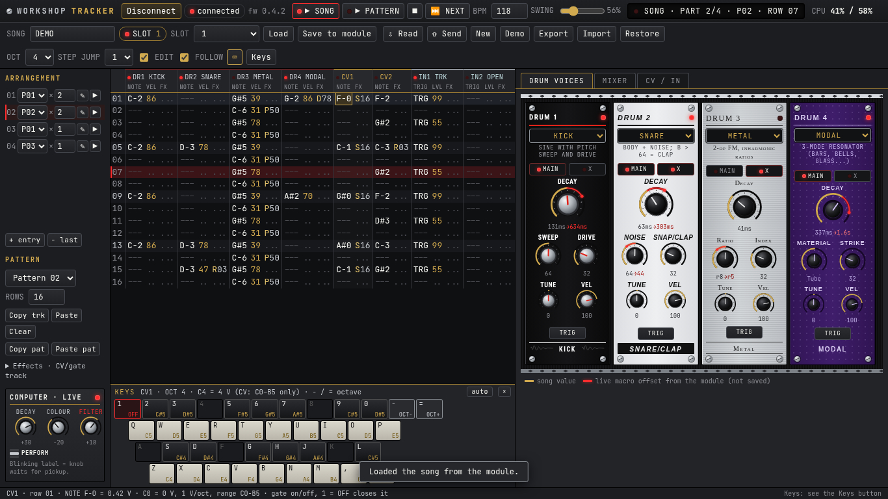
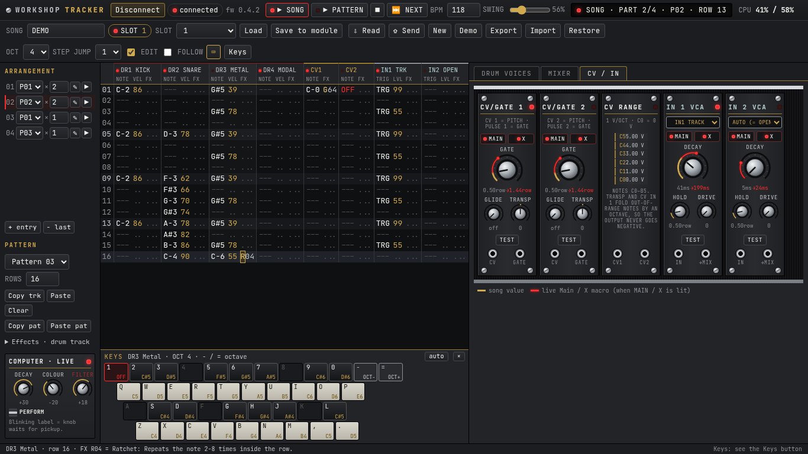
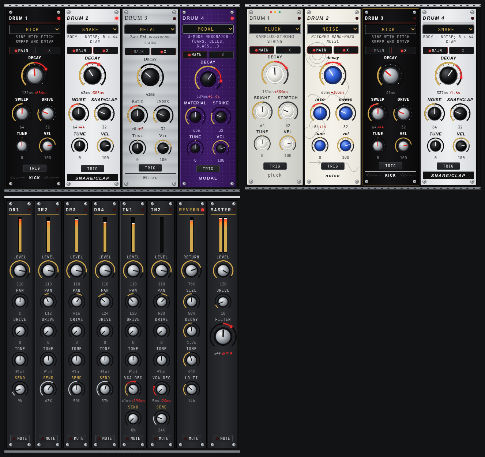
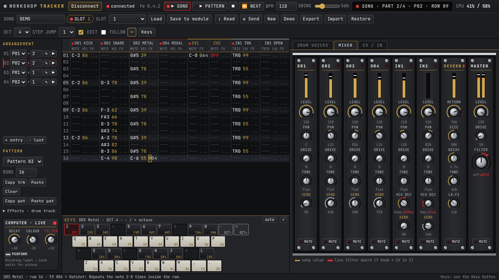

# Workshop Tracker

Ein **Tracker-Sequencer mit Drum-Synths** als Programmkarte für das
**Computer**-Modul (RP2040) des
[Music Thing Modular Workshop System](https://www.musicthing.co.uk/workshopsystem/),
dazu ein **Browser-Editor**, der das Modul über USB steuert.

* **4 Drum-Synth-Stimmen** laufen **auf dem Modul**: Kick, Karplus-Strong-Pluck,
  gestimmtes Bandpass-Rauschen, 2-Operator-FM „Metal“, 3-Moden-Resonator
  „Modal“, Snare/Clap.
* **Stereo-Mixer** (Level, Pan, Drive, Tone, Mute + Master-Filter/Drive) auf
  **Audio Out 1/2**, mit einem **Lo-Fi-Stereo-Reverb** als Send-Effekt (0.4.0):
  Send-Regler pro Kanal, Return / Size / Decay / Tone / Lo-fi.
* **2 CV/Gate-Spuren** für die beiden analogen VCOs: kalibriertes
  **1 V/Okt an CV Out 1/2** (C0 = 0 V … H5 = 5,92 V, nur positive Spannungen),
  Gates an **Pulse Out 1/2**, Glide/Slide.
* **Audio In 1/2** holen die VCOs zurück in den Mix, jeweils durch einen
  **VCA**, den eine eigene **IN-Spur** spielt (Trigger, Lautstärke, Haltezeit,
  Decay, Effekte) oder das Gate der CV-Spur.
* **Tracker**: 16 Patterns × 64 Zeilen × **8 Spuren** (4 Drums, CV1, CV2, IN1,
  IN2). Jeder Step hat Note, Velocity (nicht bei CV-Spuren: ein Gate ist nur an oder aus) und **einen Effekt** (Parameter-Locks,
  Ratchets, Wahrscheinlichkeit, Mikro-Delay, Gate-Länge, Slide, Hall-Send). Werte werden
  als **00–99** angezeigt und eingegeben. Song-Arrangement mit 32 Einträgen,
  Tempo, Swing.
* **Performance-Modus ohne Computer**: 6 Song-Slots im Flash, Start / nächster
  Part / Stop mit dem Z-Schalter, Makro-Regler, externe Clock & Reset,
  CV-Modulation.

> **Status:** Die Versionen 0.1 und 0.2 liefen auf einem echten Computer (USB,
> Klang, Panel, Knopf-Rückmeldung, Editor). Die Neuerungen in **0.3** (IN-Spuren,
> CV/IN-Makros, neues Slot-Format im Flash, Fix für die Slot-Auswahl,
> Timing-Änderungen im Audio-Kern; 0.3.1 entfernt die zweite Effektspalte von
> 0.3.0 wieder; 0.3.2: nur positive CV mit C0 = 0 V, keine CV-Velocity, neuer
> Slot-Regler) sind durch Host-Tests, einen
> JS↔Firmware-Abgleich und Browser-Tests gegen ein simuliertes Modul
> abgedeckt, **liefen aber noch nicht auf Hardware**. Das gilt auch für
> **0.4.0–0.4.2** (Optimierungen im Audio-Kern + Lo-Fi-Reverb, Send pro Step,
> Live-Mutes): Host-Tests, Drum-Sounds Sample für Sample gegen 0.3.2 verglichen
> (0.4.2: ohne Mute bitgenau wie 0.4.1), CPU im Emulator gemessen; noch nicht
> auf einem Modul.
> Siehe [Bekannte Risiken](#bekannte-risiken).

English: [README.md](README.md)

## Schnellstart

1. **Karte flashen.** `workshop_tracker.uf2` herunterladen (`dist/` oder
   GitHub-Release). Karte im Computer, USB-C am Rechner: Hauptregler abziehen,
   den BOOTSEL-Knopf dahinter halten und den Load/Reset-Knopf neben dem
   Kartenschacht kurz drücken. Die UF2 auf das Laufwerk `RPI-RP2` ziehen.
   (Offizielle Anleitung:
   <https://www.musicthing.co.uk/workshopsystem/program-cards/install/>)
2. **Patchen** (Minimum): Audio Out 1/2 → Mixer / Kopfhörer (Stereo L/R).
   Für die VCOs: CV Out 1 → Pitch VCO 1, CV Out 2 → Pitch VCO 2, VCO-Ausgänge
   → Audio In 1/2. Pulse Out 1/2 sind Gates (für Hüllkurven / VCAs).
3. **Editor öffnen** in Chrome oder Edge:
   *GitHub Pages:* `https://<dein-user>.github.io/mtm-tracker/`
   *oder lokal:* `npx serve web` → <http://localhost:3000>
   (oder `cd web && python3 -m http.server 8000` → <http://localhost:8000>).
   Es muss `https://` oder `localhost` sein. `index.html` direkt von der Festplatte öffnen funktioniert nicht, weil WebMIDI-SysEx einen sicheren Kontext braucht.
4. **Connect** klicken und MIDI/SysEx erlauben. Der Editor liest den Song vom
   Modul. Änderungen gehen sofort ans Modul; **Save to module** speichert den
   Song im gewählten Flash-Slot.
5. USB jederzeit abziehen: Das Modul läuft weiter und wird über das Panel
   gespielt (siehe [docs/CONTROLS.md](docs/CONTROLS.md), englisch).

Der Editor funktioniert auch **offline** (ohne Modul). Songs werden im
Browser automatisch gesichert und lassen sich als `.wtrk.json`
exportieren/importieren.

## Der Editor

| Bereich | |
| --- | --- |
| Oben | Connect, Transport (Song / Pattern / Stop / nächster Part), BPM, Swing, CPU-Last des Moduls |
| Werkzeugleiste | Songname, **SLOT n** (der Slot, den das Modul spielt; `· edited`, wenn der Editor ungespeicherte Änderungen hat), Flash-Slot laden/speichern, vom Modul lesen / ans Modul senden, Neu, Demo, Export/Import, Oktave, **STEP JUMP** (um wie viele Zeilen der Cursor nach einer Eingabe springt), Edit-Modus, Follow, **⌨** Tastatur-Skizze an/aus, Keys (Hilfe) |
| Links | Song-Arrangement (Pattern × Wiederholungen, ▶ startet bzw. springt zu einem Eintrag), Pattern-Auswahl & -Länge, Kopieren/Einfügen/Löschen, **Effekt-Legende** für die Spur unter dem Cursor |
| Mitte | das Tracker-Raster; darunter eine **Statuszeile**, die das Feld unter Maus oder Cursor erklärt |
| Links unten | **Computer · Live**: die Regler Main/X/Y und die Z-Stellung des Moduls in Echtzeit |
| Rechts, Tab **Drum voices** | vier Module im Eurorack-Stil: Engine, Zuordnungs-Tasten **MAIN** / **X**, Drehregler Decay, A, B, Tune, Vel; die rote LED leuchtet bei jedem Schlag. Jedes Modul trägt eine Frontplatte passend zur Engine (0.4.2, siehe unten) |
| Rechts, Tab **Mixer** | DR1–DR4, **IN1**, **IN2** (Audio-Eingänge), **REVERB** und Master: Level, Pan, Drive, Tone, VCA-Decay (Eingänge), **Send** (zum Reverb), ein **MUTE**-Schalter auf jedem Streifen, auch REVERB und MASTER (0.4.2), Pegel (Spitzenwert mit ≈10 ms Anstieg, ≈300 ms Abfall und 1 s Peak-Hold-Marke), Master-Filter. REVERB: Return, Size, Decay, Tone, Lo-fi, Return-Pegel und eine LED, solange die Fahne ausklingt |
| Rechts, Tab **CV / IN** | **CV/GATE 1, 2**: Gate-Länge, Glide, Transponierung, MAIN/X-Zuordnung · **CV RANGE**: Skala Note ↔ Spannung (C0 = 0 V … C5 = 5 V) · **IN 1, 2 VCA**: Quelle (OPEN / CV GATE / IN TRACK), Decay, Hold, Drive, MAIN/X-Zuordnung, TEST |

**Drehregler:** hoch/runter ziehen (Shift = fein), Mausrad, Doppelklick
setzt zurück, mit Fokus auch Pfeiltasten / Bild↑↓ / Pos1 / Ende.

**Rückmeldung vom Modul (ab Firmware 0.2):** Die PERFORM-Makros des Moduls
sind **Offsets** auf die Werte im Song und werden nie gespeichert. Im Editor
zeigt der **goldene Bogen** den Song-Wert und ein **roter Bogen mit Punkt**,
was das Modul gerade spielt (Main: Drum-Decay, CV-Gate-Länge, IN-VCA-Decay;
X: Parameter A, CV-Glide, IN-Drive; Master-Filter über Y + CV In 2). Tempo,
Swing, Slot und Position vom Panel werden live angezeigt. Pro Drum-Voice,
CV-Spur und Audio-Eingang legen **MAIN** und **X** fest, ob das Main- bzw.
X-Makro darauf wirkt. Die Zuordnung wird im Song gespeichert.

### Frontplatten der Drum-Module (0.4.2)

Der Tab Drum voices sieht aus wie eine kleine Eurorack-Reihe: Jedes
Drum-Modul wechselt seine Frontplatte, wenn eine andere Engine gewählt wird.
Nur die Optik ändert sich (Platte, Beschriftung, Reglerkappen); Regler, ihre
Positionen und ihre Funktion sind bei jeder Engine gleich. Auf den Platten
stehen keine Logos oder Markennamen; jede ist von einem echten Modul auf
ModularGrid inspiriert:

| Engine | Frontplatte | Inspiriert von |
| --- | --- | --- |
| Kick | schwarz, weiße fette schmale Versalien, rote Linie unter dem Titel, silberne Knöpfe mit rotem Zeiger, abklingende Sinuslinie am Namensschild | [Befaco Kickall](https://modulargrid.net/e/befaco-kickall) |
| Pluck | helles Aluminium, ruhige dunkle Grotesk, große weiße Knöpfe, drei farbige Punkte, gestrichelte Führungslinien | [Mutable Instruments Rings](https://modulargrid.net/e/mutable-instruments-rings) |
| Noise | cremefarben mit dünnen schwarzen Kritzel-Linien (Spiralen, Pfeile, Zickzack), kursive Kleinbuchstaben, blaue Knöpfe | [Make Noise Wogglebug](https://modulargrid.net/e/make-noise-wogglebug) |
| Metal | gebürstetes Aluminium, Serifen-Kapitälchen, schwarze Knöpfe mit weißem Strich | [Mannequins Mangrove](https://modulargrid.net/e/mannequins-mangrove) |
| Modal | tiefes Lila mit feinem Punktraster, Lavendel-Schrift, kleine schwarze Knöpfe | [Noise Engineering Basimilus Iteritas Alter](https://modulargrid.net/e/noise-engineering-basimilus-iteritas-alter) |
| Snare | silberweiß, schwarze fette kursive Versalien, gerändelte schwarze Knöpfe, schwarzes Namensschild | [Tiptop Audio SD909](https://modulargrid.net/e/tiptop-audio-sd909) |

Der goldene (Song-Wert) und der rote Bogen (Live-Makro) sind auf allen Platten
gleich; Schriftgrößen und Farben sind auf Kontrast geprüft (Beschriftung ≥ 9:1,
Werte ≥ 5:1, der rote Live-Wert auf den hellen Platten ≥ 5:1). Mixer, CV / IN
und der Rest des Editors behalten den Workshop-System-Look. Die dekorativen
Mini-Buchsen unten an den Drum-Modulen und Mixer-Streifen sind weg (sie taten
nichts); der Tab CV / IN behält seine Buchsen-Beschriftung, weil sie die
echten Buchsen benennt. Mehr:
[docs/screenshot-voices-models-1366x768.png](docs/screenshot-voices-models-1366x768.png).

### Lo-Fi-Reverb (0.4.0)

Ein absichtlich sparsamer, körniger Stereo-Hall im Stil früher Digitalhalls,
der neben den Drums auf dem Modul läuft. Jeder Mixer-Kanal hat einen
**Send**-Regler (nach Level und Mute; quadratische Kennlinie, 50 % ≈ −12 dB).
Der Return geht vor Master-Filter und -Drive in die Summe.

| Regler | Bereich | Wirkung |
| --- | --- | --- |
| Return | 0–100 % (≈71 % = 0 dB, 100 % = +6 dB) | Hall-Anteil in der Summe |
| Size | 40–100 % | Länge der vier Delay-Lines (71–125 ms bei 100 %); beim Drehen biegt die Tonhöhe der Fahne kurz wie bei einem Band |
| Decay | 0,3–9 s | Zeit bis −60 dB |
| Tone | dunkel … hell | Dämpfung in der Fahne |
| Lo-fi | sauber … rau | wirft untere Bits der Fahne weg (16 → 9 Bit), leichtes Leiern, ab 50 % Sample-and-Hold-Ausgabe (Aliasing) |

Innen: Die Send-Summe wird auf **16 kHz** gemittelt, läuft durch zwei
Allpass-Diffusoren in ein **Feedback-Delay-Netz mit 4 Lines** (Hadamard-Matrix,
je ein Dämpfungs-Tiefpass und eine Abklingverstärkung, 16-Bit-Lines); links
und rechts greifen verschiedene Lines ab, deshalb ist das Stereobild breit
(L/R-Korrelation des Returns ≈ −0,2). Wenn nichts hineingeht und die Fahne
unter der Auflösung des Ausgangs liegt, schaltet sich der Hall ab (keine CPU,
exakt still). Songs aus älteren Versionen laden mit allen Sends auf 0 und
klingen genau wie vorher. Zum Anhören:
[docs/audio/demo_dry.wav](docs/audio/demo_dry.wav) und
[docs/audio/demo_reverb.wav](docs/audio/demo_reverb.wav) (Demo-Song trocken und mit
etwas Send auf der Kick und mehr auf Drums 2–4; vom Firmware-Code auf dem Host
gerendert).

**Mutes (0.4.2).** Jeder Mixer-Streifen hat einen **MUTE**-Schalter. DR1–DR4,
IN1 und IN2 schalten ihren Kanal (samt Send) stumm; das sind Song-Werte und
werden wie bisher im Slot gespeichert. **REVERB** schaltet nur den Return
stumm: Der Hall läuft weiter, beim Aufheben ist die noch klingende Fahne
wieder da. **MASTER** schaltet den ganzen Ausgang stumm. Beide blenden in ≈ 5 ms
(kein Knacken), sind **Live-Schalter und werden nicht im Song gespeichert**
(ein Slot, der auf der Bühne stumm hochfährt, wäre eine Falle) und sind nach
dem Einschalten aus. Sie brauchen Firmware 0.4.2 (Protokoll 7); mit älterer
Firmware sind sie ausgegraut. Ohne Mute ist der Ausgang bitgenau wie bei 0.4.1.

### Das Raster

Jede Spur hat kleine Spalten-Labels: **NOTE VEL FX** (CV-Spuren: **NOTE FX**,
IN-Spuren: **TRIG LVL FX**). Jeder Step hat einen Effekt. Zeilen und Patterns zählen ab 01.
Alle Werte sind zwei Dezimalziffern, **00–99** (intern wo nötig 0–127); `..`
heißt „Standard“. Die Schriftgröße des Rasters passt sich dem Fenster an, damit
alle 8 Spuren ohne seitliches Scrollen passen (13 px bei 1366×768, 16 px bei
1920×1080).

| Spur | NOTE / TRIG | VEL / LVL |
| --- | --- | --- |
| Drum 1–4 | Tonhöhe, `OFF` würgt ab | Anschlagstärke (`..` = 79) |
| CV1, CV2 | Tonhöhe an CV Out (**C-0 … B-5 = 0 … 5,92 V**, die Oktavziffer ist die Spannung), Gate an Pulse Out, `OFF` = Gate aus | – (keine Velocity: ein IN-VCA, der dem CV-Gate folgt, öffnet voll, die Lautstärke kommt vom Mixer) |
| IN1, IN2 | jede Notentaste = Trigger (Anzeige `TRG`), `OFF` schließt | VCA-Lautstärke (`..` = voll) |

Ein Trigger in einer IN-Spur stellt die VCA-Quelle dieses Eingangs auf IN TRACK
(der Editor sagt Bescheid); ändern lässt sie sich im Tab CV / IN.

**Effekte:** Klick auf eine FX-Zelle oder **Enter** darauf öffnet eine Liste der
Effekte, die auf dieser Spur funktionieren, mit kurzer Beschreibung. Oder den
Buchstaben tippen. Die Legende links zeigt sie ebenfalls, und die Statuszeile
nennt den Effekt unter dem Cursor.

| FX | Spuren | Wert |
| --- | --- | --- |
| `A` Param-A-Lock | Drum | A für diesen Schlag, 00–99 |
| `B` Param-B-Lock | Drum | B für diesen Schlag, 00–99 |
| `D` Decay-Lock | Drum, IN | Decay / VCA-Release für diesen Schlag, 00–99 |
| `G` Gate-Länge | CV, IN | 1/16 Zeile: 08 = halbe Zeile, 16 = eine Zeile, 00 = halten |
| `S` Slide | CV | Glide in diese Note, Gate bleibt an, 00–99 |
| `R` Ratchet | alle | 02–08 Wiederholungen in der Zeile |
| `P` Wahrscheinlichkeit | alle | Chance in %, 00–99 |
| `K` Verzögerung | alle | n/16 Zeile später, 01–15 |
| `W` Reverb-Send | Drum, IN | Hall-Send für diesen Schlag, 00–99 (0.4.1) |

**`W` (Hall-Send pro Schlag, Firmware 0.4.1).** `W` („wet“; R ist schon der
Ratchet) setzt den Reverb-Send des Kanals für diesen Schlag statt des
Send-Reglers im Mixer, mit derselben Kennlinie (50 ≈ −12 dB, 99 = voll, nach
Level und Mute). Die ganze Ausklingphase des Schlags behält diesen Send bis
zum nächsten Schlag auf derselben Spur; ein Schlag ohne `W` nimmt wieder den
Regler. Ratchets wiederholen ihn, ein von `P` übersprungener Step ändert
nichts. Der Wechsel gleitet in höchstens ≈5 ms, deshalb knackst nichts im
Hall. Der trockene Klang bleibt unberührt. CV-Spuren sind nicht im Mix, dort
bietet der Editor `W` nicht an (die Firmware ignoriert es). Firmware 0.4.0 und
älter ignorieren den Buchstaben, Songs bleiben in beide Richtungen kompatibel.

**CV-Spannungen.** CV Out ist 1 V/Oktave mit **C0 = 0 V**: `C-0` = 0 V, `C-1` =
1 V, `A-2` = 2,75 V, bis `B-5` (H5) = 5,917 V. Es gibt nur positive Spannungen
(die VCOs des Workshop Systems folgen unter 0 V nicht), deshalb endet die
Oktavwahl auf CV-Spuren bei 5, und Noten über H5 werden eine Oktave tiefer
gelegt. Transponieren (*Transp* der Spur, CV In 1), das 0…5,92 V verlassen
würde, wird ebenfalls oktavweise zurückgefaltet; CV Out wird also nie negativ.
Songs älterer Versionen werden umgewandelt: CV-Noten behalten ihre Spannung (mit
der alten Voreinstellung „0-V-Note = C2“ wird aus `C-2` ein `C-0`), Noten, die
früher bei 0 V oder 6 V klebten, rücken oktavweise in den Bereich, und
CV-Velocities fallen weg.

**Tastatur-Skizze.** Unter dem Raster zeichnet der Editor die Computertastatur
(an/aus mit **⌨**, auch im *Keys*-Dialog): jede Taste zeigt ihren Buchstaben und
die Note, die sie in der aktuellen Oktave für die Spur unter dem Cursor spielt
(IN-Spuren: `TRG`). `1` (rot) ist OFF, `ß` / `´` (silber; US: `-` / `=`)
wechseln die Oktave. Die Tasten werden nach Position erkannt; meldet der
Browser ein deutsches Layout, beschriftet die Skizze QWERTZ, der Knopf
QWERTY / QWERTZ stellt die Beschriftung von Hand um. Die gedrückte Taste
leuchtet kurz auf.

**Tasten** (*Keys* in der App zeigt alle): Klaviatur auf `Y/Z S X D C V…`
(untere Oktave; die Tasten werden nach Position erkannt, deutsches Layout
funktioniert also) und `Q 2 W 3 E R…` (obere), `1` = Note OFF, Ziffern `0-9`
in den VEL- und Wert-Spalten (eine Ziffer, dann eine zweite für zwei Stellen:
`7` `5` = 75), `Shift+↑/↓` = ±1 (`Shift+Bild↑↓` = ±10), Effektbuchstaben oder
`Enter` in den FX-Spalten, `Entf` löscht, Pfeile / Tab / Bild↑↓ bewegen,
`ß`/`´` (bzw. `-`/`=`) ändern die Oktave, `Leertaste` startet/stoppt das
Pattern, `Enter` in NOTE/VEL spielt den Song, `Strg+C / Strg+V` kopiert/fügt
eine Spur ein.

**Slot-Wechsel am Modul.** Wechselt der Slot-Regler am Modul (Z oben) auf
einen anderen Song, merkt der Editor das (Song-Wechselzähler im Status) und
liest den neuen Song. Hatte der Editor **ungespeicherte Änderungen** (die
SLOT-Anzeige sagt `· edited`), werden sie vorher im Browser gesichert, und ein
Hinweis sagt das; **Restore** holt sie zurück (danach *Send to module* oder
*Save to module*). Nichts geht stillschweigend verloren.

**Ältere Firmware:** Mit Firmware 0.3.1 funktioniert alles; der Editor legt die
CV-Noten in C0–H5, setzt die 0-V-Note des Moduls auf C0 und empfiehlt das Update
(Slot-Regler-Zonen, Faltung von CV In 1). Mit Firmware 0.2 zeigt der Editor einen Hinweis, blendet
die IN-Spuren abgedunkelt ein (werden nicht gesendet) und wandelt Songs vom
Modul beim Lesen um. Mit Firmware 0.3.0 (die noch eine zweite Effektspalte
hatte) funktioniert alles; der Editor löscht beim Schreiben eines Steps dessen
zweiten Effekt und empfiehlt das Update. Songs von 0.3.0 behalten nur einen
Effekt (der zweite fällt weg oder rückt nach, wenn die erste Spalte leer war).

## Stimmen

Alle Klangerzeugung läuft als Festkomma-DSP mit 48 kHz (der RP2040 hat keine
FPU), Hüllkurven und Koeffizienten mit Control-Rate (alle 8 Samples).

| Engine | Algorithmus | A | B |
| --- | --- | --- | --- |
| **Kick** | Sinus mit exponentiellem Pitch-Sweep (bis ~8× Startton) und Soft-Clip-Drive | Sweep-Tiefe | Drive |
| **Pluck** | Karplus-Strong-Saite: Rauschimpuls in eine Delay-Leitung mit Bruchteil-Verzögerung und Dämpfungsfilter; Verlust tonhöhenabhängig, damit die Abklingzeit überall ähnlich ist | Helligkeit des Anschlags | Dämpfung / Stretch |
| **Noise** | weißes Rauschen durch einen resonanten State-Variable-Bandpass auf der Notenfrequenz, mit Hüllkurven-Sweep und Lautheitsausgleich | Resonanz (von Rauschen bis Pfeifen) | Sweep |
| **Metal** | 2-Operator-FM mit unharmonischen Verhältnissen und eigener Index-Hüllkurve (Glocken, Cowbells, metallische Hats) | Verhältnis | FM-Index |
| **Modal** | kurzer gefilterter Rauschanschlag in **drei gestimmte Resonatoren** mit Verhältnissen aus 8 Materialien: Membran, Marimba, Glockenspiel, Glocke, Röhre, Platte, Glas, Gong | Material | Anschlaghärte |
| **Snare** | Sinus-Körper mit Pitch-Drop + Bandpass-Rauschen; B ≥ 64 macht daraus einen **Clap** (drei Rauschstöße) | Rauschanteil | Snap / Clap |

## Panel und Buchsen

| Buchse | Funktion |
| --- | --- |
| Audio Out 1/2 | Stereo-Mix L/R |
| Audio In 1/2 | Mixer-Kanäle **IN1 / IN2** (z. B. die VCOs) durch einen VCA, gespielt von der IN-Spur oder dem CV-Gate |
| CV Out 1/2 | 1 V/Okt der CV-Spuren 1/2 (kalibriert), C0 = 0 V … H5 = 5,92 V |
| Pulse Out 1/2 | Gates der CV-Spuren 1/2 |
| Pulse In 1 | Clock-Eingang, 1 Puls = 1 Zeile (ersetzt die interne Clock, solange gesteckt) |
| Pulse In 2 | Reset |
| CV In 1 | Transponierung der CV-Spuren, 1 V/Okt (oktavweise gefaltet, nie unter 0 V) |
| CV In 2 | Modulation des Filter-Makros |

| Z | Main | X | Y |
| --- | --- | --- | --- |
| **Mitte** (PERFORM) | Decay-Makro (zugeordnete Voices), CV-Gate-Länge, IN-VCA-Decay | Farbe-Makro (Parameter A, zugeordnete Voices), CV-Glide, IN-Drive | Master-Filter LP ↔ HP |
| **Oben** (SELECT) | Song-Slot: der Regelweg wird auf die belegten Slots aufgeteilt (2 → 50 %, 3 → 33 / 66 %) | Tempo 40–240 | Swing 50–75 % |
| **Unten** (tastend) | kurz: Start / nächster Part · 0,8 s halten: Stop | | |

Tempo, Swing und Makros nutzen Soft-Takeover (der Regler greift erst, wenn er
den aktuellen Wert überfährt; eine LED blinkt solange). LED-Bedeutungen:
[docs/CONTROLS.md](docs/CONTROLS.md).

## Technik in Kürze

* **Protokoll:** USB-MIDI-SysEx (`F0 7D 54 …`), wie das offizielle
  ComputerCard-Beispiel `web_interface` und ~30 veröffentlichte Karten: kein
  Treiber, automatische Port-Erkennung, läuft parallel zu einer DAW.
  [docs/PROTOCOL.md](docs/PROTOCOL.md), [docs/RESEARCH.md](docs/RESEARCH.md).
* **Flash:** 6 Song-Slots (33-KB-Datensätze im Abstand von 52 KB,
  CRC-geprüft; Slots von 0.3.0 und 0.1/0.2 werden beim Laden umgewandelt), geschrieben von Core 1
  Sektor für Sektor. Die Firmware läuft komplett aus dem RAM
  (`copy_to_ram`), deshalb läuft das Audio beim Speichern weiter.
* **CPU:** 192 MHz. Nur Engine, im Emulator: Demo-Song ≈ 36 % im Schnitt / 46 %
  im teuersten Sample (mit Reverb 42 % / 54 %), Leerlauf 21 %; ein absichtlich
  extremer Worst Case 76 % / 91 % (mit Reverb auf allen sechs Kanälen voll
  aufgedreht 83 % / 97 %).
  [docs/CPU_BUDGET.md](docs/CPU_BUDGET.md). Das Modul meldet seine gemessene
  Last an den Editor.

## Bauen

Siehe [README.md](README.md#building) (Pico SDK 2.2.0, ARM GCC 14, Host-Tests
mit g++ und `node --test`).

## Was fehlt (noch)

* nur ein Send-Effekt (der Lo-Fi-Reverb, kein Delay); der Reverb hat keinen
  Regler am Panel und keinen Effekt-Buchstaben pro Step;
* nur USB-**Device**-Modus (keine USB-MIDI-Keyboards direkt am Modul);
* externe Clock fest **1 Puls = 1 Zeile**;
* Decay-/Farbe-Makros wirken auf neue Anschläge, nicht auf klingende Noten;
* die Reglerstellungen des Moduls werden im Editor angezeigt, lassen sich dort aber nicht verstellen (es sind echte Potis);
* kein Mute/Solo im Raster (Mixer-Mute benutzen), kein Undo;
* Song-Wechsel am Panel nur zwischen den gespeicherten Slots;
* der Eigenverbrauch von ComputerCard ist geschätzt, nicht gemessen.

## Bekannte Risiken

* 0.1 und 0.2 wurden auf Hardware bestätigt. **0.3** wurde nur simuliert
  getestet: die IN-VCAs mit echtem Audio, **die CV-Spannungen von 0.3.2
  (C0 = 0 V, das Falten um Oktaven, CV In 1 an den Bereichsgrenzen) an echten
  VCOs, die Zonen des Slot-Reglers und ihre Hysterese mit einem echten Poti, die
  Slot-LEDs, das Mitlesen eines Slot-Wechsels mit echtem USB-Timing,** das Umwandeln
  echter 0.2- und 0.3.0-Slots, das Schreiben der Slots (9 Sektoren) bei laufendem
  Audio, der Fix für die Slot-Auswahl am Panel und die Timing-Änderungen im
  Audio-Kern (ein Ratchet-/Gate-Ereignis pro Sample, Mixer-/VCA-Updates in
  vollen Samples verschoben). Die Langzeitstabilität bei 192 MHz / 1,15 V
  braucht noch mehr Praxis.
* **0.4.2** ist nicht auf Hardware getestet: die REVERB-/MASTER-Mutes und ihre
  Blenden an echten Ausgängen; die neuen Frontplatten sind nur in Headless
  Chrome geprüft (1366×768 und 1920×1080, ohne Scrollen), nicht in anderen
  Browsern oder auf HiDPI-Bildschirmen.
* **0.4.0/0.4.1** ist nicht auf Hardware getestet: der Hall-Send pro Step `W`, Klang und Pegel des Reverbs an
  echten Ausgängen, seine CPU-Last zusammen mit dem Eigenverbrauch von
  ComputerCard und die Änderungen im Audio-Kern (Anschläge starten 1 Sample
  nach dem Trigger, Modal 2; Ereignisse werden auf benachbarte Samples
  verteilt, im Worst Case ≤ 7 Samples = 0,15 ms; Stimmen enden, sobald sie unter
  der Ausgangsauflösung liegen; LEDs eine pro Sample; CV nur bei Änderung).
* Die RAM-Belegung liegt bei ≈ 70 % (0.3.2: 60 %; die Delay-Lines des Reverbs
  belegen ≈ 17 KB).
* Der extreme CPU-Worst-Case liegt nahe am Limit (mit vollem Reverb auf allen
  Kanälen erreichen einzelne Samples ≈ 97 % des Engine-Budgets, ohne den
  Eigenverbrauch von ComputerCard); normale Songs haben viel Luft. Bei
  Knacksern die CPU-Anzeige im Editor prüfen und Sends/Decay zurücknehmen.
* Speichern überschreibt den Slot. Fällt dabei der Strom aus, ist dieser Slot
  danach leer (CRC), nie halb kaputt; andere Slots bleiben erhalten.
* Braucht einen Chromium-Browser (WebMIDI mit SysEx).

## Lizenz

MIT, siehe [LICENSE](LICENSE). ComputerCard: MIT © Chris Johnson.
