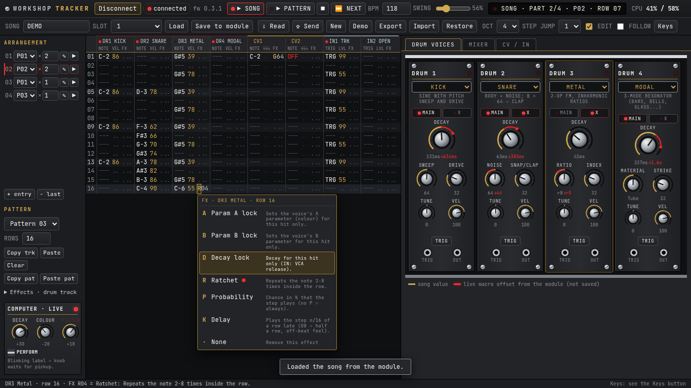
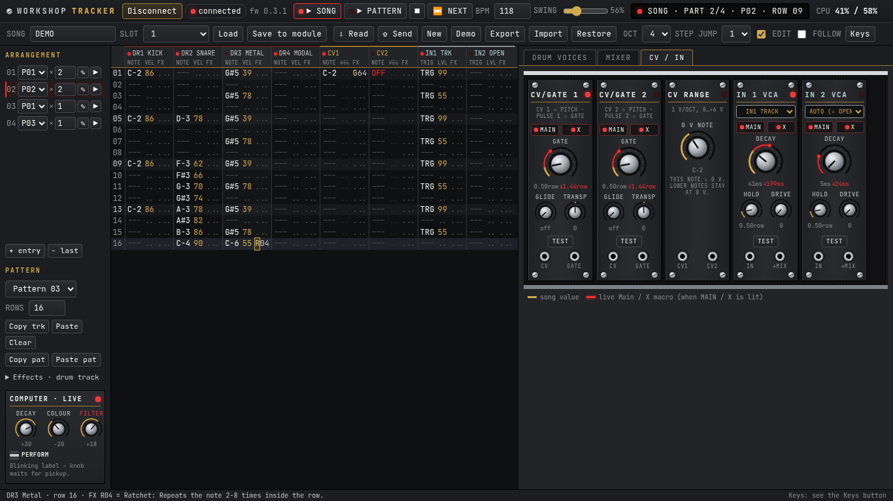

# Workshop Tracker

A **tracker sequencer and drum synth program card** for the
[Music Thing Modular Workshop System](https://www.musicthing.co.uk/workshopsystem/)
**Computer** module (RP2040), plus a **browser editor** that controls it over
USB.

* **4 drum-synth voices** run **on the module**: Kick, Karplus-Strong Pluck,
  pitched band-pass Noise, 2-op FM Metal, 3-mode Modal resonator, Snare/Clap.
* A **stereo mixer** (level, pan, drive, tone, mute + master filter/drive) to
  **audio out 1/2**.
* **2 CV/gate tracks** for the Workshop System's two analogue VCOs: calibrated
  **1 V/oct on CV out 1/2**, gates on **pulse out 1/2**, glide/slide.
* **Audio in 1/2** bring the VCOs back into the mix through a **VCA each**,
  played by its own **IN track** (trigger, level, hold, decay, effects) or by
  the CV track's gate and velocity.
* **Tracker**: 16 patterns × 64 rows × **8 tracks** (4 drums, CV1, CV2, IN1,
  IN2). Each step has note, velocity and **one effect** (param locks, ratchets,
  probability, micro-delay, gate length, slide). Values are shown and typed as
  **00–99**. A 32-step song arrangement, tempo, swing.
* **Performance mode without a computer**: 6 song slots in flash, start / next
  part / stop on the Z switch, knob macros, external clock & reset, CV
  modulation.

> **Status:** versions 0.1 and 0.2 have been tested on a real Computer (USB,
> sound engines, panel, knob feedback, editor). The **0.3** additions (IN
> tracks, CV/IN macros, new flash slot format, slot-select fix, timing changes
> in the audio core; 0.3.1 removed 0.3.0's second effect column again) are
> covered by host tests, a JS↔firmware cross-check and headless-browser tests against a simulated
> module, but **have not run on hardware yet**. See [Known risks](#known-risks).



Deutsch: [README.de.md](README.de.md)

## Quick start

1. **Flash the card.** Download `workshop_tracker.uf2` (in `dist/` or from
   the GitHub release). With the card in the Computer and USB-C plugged into
   your computer, pull off the main knob, hold the BOOTSEL button behind it, and
   tap the load/reset button next to the card slot. Drag the UF2 onto the
   `RPI-RP2` drive. (Official guide:
   <https://www.musicthing.co.uk/workshopsystem/program-cards/install/>)
2. **Patch** (minimum): audio out 1/2 → mixer / headphones (stereo L/R).
   For the VCOs: CV out 1 → VCO 1 pitch, CV out 2 → VCO 2 pitch, VCO outputs →
   audio in 1/2. Pulse out 1/2 are gates (envelopes / VCAs) if you want them.
3. **Open the editor** in Chrome or Edge:
   *GitHub Pages:* `https://<your-user>.github.io/mtm-tracker/`
   *or locally:* `npx serve web` → <http://localhost:3000>
   (or `cd web && python3 -m http.server 8000` → <http://localhost:8000>).
   It must be `https://` or `localhost`. Opening `index.html` from disk does not work, because WebMIDI SysEx needs a secure context.
4. Click **Connect** and allow MIDI/SysEx access. The editor reads the song
   from the module. Edits go to the module immediately; **Save to module**
   writes the song to the selected flash slot.
5. Unplug USB whenever you like: the module keeps running and is played
   from the panel (see [docs/CONTROLS.md](docs/CONTROLS.md)).

The editor also works **offline** (no module). Songs are autosaved in the
browser and can be exported/imported as `.wtrk.json`.

## The editor

| Area | |
| --- | --- |
| Top bar | Connect, transport (song / pattern / stop / next part), BPM, swing, position readout (mode · part · pattern · row, beat LED), CPU load of the module |
| Toolbar | song name, flash slot load/save, read from / send to module, new, demo, export/import, octave, **step jump** (rows the cursor moves after an entry), edit mode, follow |
| Left | song arrangement (pattern × repeats, ▶ to start or cue an entry), pattern selector & length, copy/paste/clear, **effect legend** for the track under the cursor, **Computer · Live** panel (the module's Main/X/Y knobs and Z page) |
| Centre | the tracker grid; below it a **status line** that explains the field under the mouse or cursor |
| Right, tab **Drum voices** | four Eurorack-style modules: engine, routing buttons **MAIN** / **X**, knobs Decay, A, B, Tune, Vel; the red LED lights on every hit |
| Right, tab **Mixer** | DR1–DR4, **IN1**, **IN2** (audio inputs) and Master: level, pan, drive, tone, VCA decay (inputs), mute, meters, master filter |
| Right, tab **CV / IN** | **CV/GATE 1, 2**: gate length, glide, transpose, MAIN/X routing · **CV RANGE**: the 0 V note · **IN 1, 2 VCA**: source (OPEN / CV GATE / IN TRACK), decay, hold, drive, MAIN/X routing, TEST |

**Knobs:** drag up/down (Shift = fine), mouse wheel, double-click resets,
and arrow keys / PgUp / PgDn / Home / End work when a knob is focused.

**Live feedback from the module (firmware ≥ 0.2):** the module's PERFORM
macros are **offsets** on top of the song values, never saved. In the editor
the **gold arc** is the song value, and a **red arc + dot** is what the module
plays right now (drum Decay, CV gate length and IN VCA decay via Main; param
A, CV glide and IN drive via X; master Filter via Y + CV in 2). Tempo, swing, slot and play position changed on the panel are shown
live. Per drum voice, CV track and audio input, **MAIN** and **X** choose
whether the Main / X macro affects it. This routing is stored in the song.



### The grid

Every track has small column labels: **NOTE VEL FX** (IN tracks:
**TRIG LVL FX**). Each step has one effect. Rows and patterns count from 01. All
values are two decimal digits, **00–99** (stored as 0–127 inside where needed);
`..` means "default". The grid font scales with the window, so all 8 tracks
always fit without scrolling sideways (12 px at 1366×768, 16 px at 1920×1080).

| Track | NOTE / TRIG | VEL / LVL |
| --- | --- | --- |
| Drum 1–4 | pitch, `OFF` chokes | how hard the voice is hit (`..` = 79) |
| CV1, CV2 | pitch on CV out, gate on pulse out, `OFF` = gate off | level of the IN VCA **only while that input follows the CV gate** (label crossed out otherwise) |
| IN1, IN2 | any note key = trigger (shown `TRG`), `OFF` closes | VCA level (`..` = full) |

Typing a trigger on an IN track switches that input's VCA source to IN TRACK
(the editor tells you); the source can be changed on the CV / IN tab.

**Effects:** click an FX cell or press **Enter** on it for a list of the
effects that work on that track, with a short description. Or type the letter.
The legend on the left lists them too, and the status line names the effect
under the cursor.

| FX | Tracks | Value |
| --- | --- | --- |
| `A` Param A lock | drum | A for this hit, 00–99 |
| `B` Param B lock | drum | B for this hit, 00–99 |
| `D` Decay lock | drum, IN | decay / VCA release for this hit, 00–99 |
| `G` Gate length | CV, IN | 1/16 row: 08 = half a row, 16 = a row, 00 = hold |
| `S` Slide | CV | glide into this note, gate stays high, 00–99 |
| `R` Ratchet | all | 02–08 repeats in the row |
| `P` Probability | all | chance in %, 00–99 |
| `K` Delay | all | n/16 row late, 01–15 |

**Keys** (press *Keys* in the app for the full list): piano layout on
`Z S X D C V…` (lower octave) and `Q 2 W 3 E R…` (upper), `1` = note OFF,
digits `0-9` in the VEL and value columns (one digit, then a second one for two
digits: `7` `5` = 75), `Shift+↑/↓` = ±1 (`Shift+PgUp/PgDn` = ±10), effect
letters or `Enter` in the FX columns, `Delete` clears, arrows / Tab / PgUp /
PgDn move, `-`/`=` change the octave, `Space` plays/stops the pattern, `Enter`
in the NOTE/VEL columns plays the song, `Ctrl+C / Ctrl+V` copy/paste a track.

**Older firmware:** connected to firmware 0.2 the editor shows a banner,
dims the IN tracks (not sent), and converts songs read from the module. With
firmware 0.3.0 (which had a second effect column) everything works, the
editor clears the second effect of every step it writes and recommends the
update; songs read from 0.3.0 keep only one effect (the second is dropped, or
used if the first column was empty).

## Voices

All synthesis is fixed-point integer DSP at 48 kHz (no FPU on the RP2040),
with envelopes and coefficients at control rate (every 8 samples).

| Engine | Algorithm | A | B |
| --- | --- | --- | --- |
| **Kick** | sine oscillator with exponential pitch sweep (up to ~8× start pitch) and soft-clip drive | sweep depth | drive |
| **Pluck** | Karplus-Strong string: noise-burst excitation into a fractional-delay line with a damping filter; loss scaled by pitch so decay is even across the keyboard | brightness of the excitation | damping / stretch |
| **Noise** | white noise through a resonant Chamberlin state-variable band-pass tuned to the note, with an envelope-driven sweep and loudness compensation | resonance (from hiss to whistling) | sweep amount |
| **Metal** | 2-operator FM with a table of inharmonic ratios and its own index envelope (bells, cowbells, metallic hats) | ratio | FM index |
| **Modal** | short filtered noise strike into **three tuned resonators** (SVF band-passes) with ratios from 8 materials: membrane, marimba, glock, bell, tube, plate, glass, gong | material | strike hardness |
| **Snare** | sine body with pitch drop + band-passed noise; B ≥ 64 turns it into a **clap** (three noise bursts) | noise mix | snap / clap |

*Tune* (±48 semitones) and the note column set the pitch; *Vel sens* sets
how much velocity changes loudness. Fx `A`, `B`, `D` lock A/B/decay per hit.

## Panel and jacks

| Jack | Function |
| --- | --- |
| Audio out 1/2 | stereo mix L/R |
| Audio in 1/2 | mixer channels **IN1 / IN2** (e.g. the VCOs) through a VCA played by the IN track or the CV gate |
| CV out 1/2 | 1 V/oct pitch of CV tracks 1/2 (calibrated) |
| Pulse out 1/2 | gates of CV tracks 1/2 |
| Pulse in 1 | clock in, 1 pulse = 1 row (replaces the internal clock while plugged) |
| Pulse in 2 | reset |
| CV in 1 | transpose CV tracks, 1 V/oct |
| CV in 2 | filter macro modulation |

| Z | Main | X | Y |
| --- | --- | --- | --- |
| **Middle** (PERFORM) | decay macro (routed voices), CV gate length, IN VCA decay | colour macro (param A, routed voices), CV glide, IN drive | master filter LP ↔ HP |
| **Up** (SELECT) | song slot 1–6 | tempo 40–240 | swing 50–75 % |
| **Down** (momentary) | tap: start / next part · hold 0.8 s: stop | | |

Tempo, swing and macros use soft takeover. Details and LED meanings:
[docs/CONTROLS.md](docs/CONTROLS.md).

## How it works

```
 browser (WebMIDI) ──USB-MIDI SysEx──▶ core 1: TinyUSB, protocol, flash writes
                                          │  edits → live song (RAM)
                                          │  commands → lock-free queue
                                          ▼
                     core 0, 48 kHz ISR: sequencer → 4 voices → mixer → DACs
                                          panel, CV/gates, clock, LEDs
```

* **Protocol:** USB-MIDI SysEx (`F0 7D 54 …`), the same approach as the
  official ComputerCard `web_interface` example and ~30 released cards.
  No driver, automatic port detection, works next to a DAW. See
  [docs/PROTOCOL.md](docs/PROTOCOL.md) and [docs/RESEARCH.md](docs/RESEARCH.md).
* **Flash:** 6 song slots (33 KB records, 52 KB apart, CRC-checked; slots
  saved by 0.3.0 and 0.1/0.2 are converted when loaded) in the top of the card's flash, written by core 1 one sector at a time. The firmware runs entirely
  from RAM (`copy_to_ram`), so audio keeps running while saving.
* **Feedback:** core 1 sends a Panel report (knob positions, pickup state,
  macros, effective values, tempo/swing/slot/position) only on change, ≤ 30/s,
  while the editor is connected.
* **CPU:** 192 MHz. ≈ 50 % of the per-sample budget at the worst sample for the
  demo song (engine only, estimated), ≈ 93 % in a deliberately pathological
  worst case. See
  [docs/CPU_BUDGET.md](docs/CPU_BUDGET.md). The module reports its measured
  load to the editor.

## Building

Firmware (Pico SDK 2.2.0, ARM GCC 14):

```sh
export PICO_SDK_PATH=/path/to/pico-sdk     # with submodules (TinyUSB)
cmake -S . -B build -G Ninja -DPICO_BOARD=pico -DCMAKE_BUILD_TYPE=Release
cmake --build build
cp build/workshop_tracker.uf2 dist/
```

Tests:

```sh
# engine, sequencer, panel, protocol and flash-format unit tests (host g++)
cmake -S . -B build-host -DBUILD_HOST_TESTS=ON && cmake --build build-host && ./build-host/test_engine
# JS protocol tests + JS↔C++ cross-check (uses build-host/xcheck from the step above)
node --test web/test/*.test.mjs
```

CPU benchmark: see [docs/CPU_BUDGET.md](docs/CPU_BUDGET.md).

CI (`.github/workflows/build.yml`) runs the tests, builds the UF2, attaches it
to tagged releases and deploys `web/` to GitHub Pages (enable Pages with
source **GitHub Actions** in the repo settings).

## Layout

```
src/main.cpp              ComputerCard glue, core-1 USB/flash host
src/engine/*.h            DSP, voices, mixer, sequencer, panel, protocol, flash format (header-only, host-testable)
src/tusb_config.h, usb_descriptors.c   TinyUSB MIDI device
vendor/ComputerCard/      ComputerCard v0.4.0 (MIT, Chris Johnson)
web/                      the editor (plain HTML/CSS/ES modules, no build step)
tests/                    host unit tests, JS↔C++ cross-check helper
tools/cpu_bench/          Cortex-M0+ cycle estimate in an emulator
tools/ui-shots/           editor screenshots + layout checks against a fake module (optional, Chrome + puppeteer-core)
docs/                     protocol, controls, CPU budget, research notes
dist/                     built UF2
```

## Implemented vs. not (yet)

Implemented: everything listed at the top. Not implemented / limitations:

* no delay/reverb send (CPU budget went to the voices);
* USB **device** mode only (no USB-host MIDI keyboards);
* external clock is fixed at **1 pulse = 1 row** (no PPQN setting);
* panel decay/colour macros affect new hits, not notes already ringing;
* the module's knob positions are shown in the editor but can't be moved from it (they are physical);
* no per-track mute/solo in the grid (use the mixer mute), no undo;
* song changes from the panel are only possible between the 6 stored slots;
* ComputerCard's own interrupt overhead is estimated, not measured.

## Known risks

* 0.1 and 0.2 were confirmed on hardware. **0.3** has only been tested in
  simulation: the IN-track VCAs and CV velocity on real audio, the conversion of
  real 0.2 and 0.3.0 flash slots, the slot writes (9 sectors) while audio runs, the
  slot-select fix on the panel, and the audio-core timing changes (one
  ratchet/gate event per sample, mixer/VCA updates postponed on busy samples).
  Long-term stability at 192 MHz / 1.15 V still needs more hardware time.
* RAM use is ≈ 59 % (two 32 KB song buffers; 0.3.0 used ≈ 72 %).
* The pathological CPU worst case is close to the budget; if you hear clicks,
  check the CPU readout in the editor.
* Saving a slot overwrites it. If power fails mid-save, that slot comes back
  empty (CRC), never corrupt; the other slots are untouched.
* Requires a Chromium-based browser (WebMIDI with SysEx).

## License

MIT, see [LICENSE](LICENSE). ComputerCard is MIT © Chris Johnson
(`vendor/ComputerCard/LICENSE`). TinyUSB config/descriptor files are adapted
from the ComputerCard `web_interface` example.
